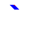
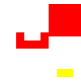
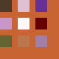

# AniCraft

An open-source 2D animation editor in pure Rust. AniCraft opens and saves Adobe Animate `XFL` and `FLA` files, edits
vector, bitmap, text and symbol timelines with classic, motion and shape tweens, and exports `SWF`, animated `GIF`,
`MP4`, `PNG` sequences and `SVG`. It runs on macOS, Windows and Linux and has a Model Context Protocol (MCP)
interface so agents can drive the same commands a person uses.

The engine lives in [anicraft-libs](https://github.com/soof-golan/anicraft-libs); the sibling project for live
character animation is [CharCraft](https://github.com/soof-golan/charcraft). Both are built on the open-source
[Craft](https://github.com/storytold) crates.

This is version 0.1.0, a pre-release. It is usable for reading, inspecting, rendering, converting and light editing of
real Animate documents; see [Known gaps](#known-gaps).

## Features

- **Documents**: open and save zipped `.fla` and folder (`.xfl`) documents. Unknown elements are kept verbatim, so a
  document that was only opened and saved keeps what AniCraft does not understand.
- **Stage and timeline**: scenes, layers (normal, guide, mask, folder), keyframes, frame labels, nested symbols with
  full matrices and skew, color effects, blend modes and filters (blur, glow, drop shadow and others).
- **Animation**: classic tweens with easing and rotation, motion guides (orient to path, snap), shape tweens with
  shape hints, onion skins.
- **Drawing**: edge-based vector shapes with solid, gradient and bitmap fills and the XFL stroke kinds; pen, line,
  rectangle, oval, brush, selection, free transform, paint bucket and boolean path operations.
- **Text**: static, dynamic and input text, with right-to-left scripts (Hebrew, Arabic) and mixed-direction text.
- **Import**: PNG, JPEG, GIF, BMP, WebP, PSD, AI, PDF and SVG into the library.
- **Export**: `SWF`, animated `GIF`, `MP4` (H.264, with AAC audio from sound layers), `MOV` (ProRes 4444), `PNG`
  sequences, still and animated `SVG`, sprite sheets.
- **MCP**: everything the UI does is a command; `anicraft-cli mcp` serves them headless, and `anicraft --control-port`
  lets an agent drive the open window and take real screenshots. See [docs/mcp.md](docs/mcp.md).

## Install

Download a package from the [releases page](https://github.com/soof-golan/anicraft/releases): Linux `tar.gz`, macOS
(Apple silicon and Intel) and Windows `zip`, with `SHA256SUMS`. The binaries are unsigned: on macOS right-click the app
and choose Open the first time; on Windows choose More info, then Run anyway in SmartScreen.

## Using it

```sh
anicraft MY.fla                          # the editor
anicraft MY.fla --frame 12 --screenshot out.png

anicraft-cli info MY.fla                 # scenes, layers, frames, library, warnings
anicraft-cli render MY.fla --frame 12 -o frame12.png
anicraft-cli export MY.fla --format mp4 --from 1 --to 120 -o out.mp4
anicraft-cli export MY.fla --format swf -o out.swf
anicraft-cli convert MY.fla MY-folder    # .fla <-> XFL folder
anicraft-cli mcp --file MY.fla           # MCP server on stdin/stdout
```

## Screenshots

Rendered by `anicraft-cli` from this repository's own synthetic test documents; no Adobe content is used anywhere in
this repository. They are the committed golden renders, each with a written prediction next to its fixture
(`apps/anicraft-cli/tests/fixtures/visual/*.expect.md`).

| Nested symbols with skew | Masks | Blend modes |
|---|---|---|
|  |  |  |

## Fidelity

Checked against two large Adobe-authored documents (a 1920x1080, 3000-frame character animation and a text-and-tween
choreography) by rendering frames, exporting GIF, MP4 and SWF, and reading the outputs back (ffprobe for video, a
tag-stream parser for SWF). Shapes, gradients, nested symbols, tweens, filters and text render plausibly there. Those
files are never committed; tests that need them read `ANICRAFT_SAMPLES` and are skipped when it is unset.

## Building

```sh
cargo build -p anicraft -p anicraft-cli
cargo test --workspace
```

Rust 1.99.1 is pinned in `rust-toolchain.toml`. On Linux install the development packages that
`.github/workflows/ci.yml` lists (ALSA, udev, xkbcommon, Wayland, X11, GL, GTK 3, fontconfig). The engine crates come
from `anicraft-libs`, pinned by git rev in `Cargo.toml`.

## Known gaps

- Parts of the Animate format are kept in the file but not interpreted: components, 3D transforms, inverse kinematics
  (armatures) and ActionScript. Dashed, dotted and hatched strokes render as solid.
- SWF output is checked against Ruffle's renderer on synthetic fixtures, and by parsing and round trips on the
  samples. It has not been checked in Adobe's Flash Player.
- Some panels (properties, library preview) are basic.
- Large documents are slow to export (software rendering and encoding).
- Binaries are unsigned and there is no installer.

## Crates

| Crate | What |
|---|---|
| `anicraft-swf` | SWF writer: header, tags, shapes with gradients and bitmap fills, sprites, sounds, from display lists |
| `anicraft-xfl` | XFL folder and zipped FLA reader/writer on the `anim-scene` model |
| `anicraft-tools` | Drawing and selection tools as pure functions from pointer events to commands |
| `anicraft` | The desktop app (`apps/anicraft`) |
| `anicraft-cli` | Headless inspect, render, export, convert and MCP (`apps/anicraft-cli`) |

See [AGENTS.md](AGENTS.md) for the rules every change follows.

## License

Dual-licensed under [MIT](LICENSE-MIT) or [BSD-3-Clause](LICENSE-BSD-3-Clause), at your option. Third-party code
and assets are listed in [ATTRIBUTION.md](ATTRIBUTION.md).

This project is not affiliated with or endorsed by Adobe. Adobe, Animate, Flash and SWF are trademarks or
registered trademarks of Adobe Inc.; they are named here only to describe file compatibility.
